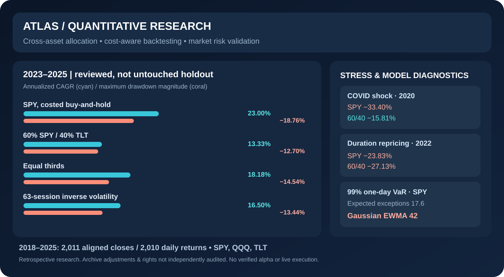
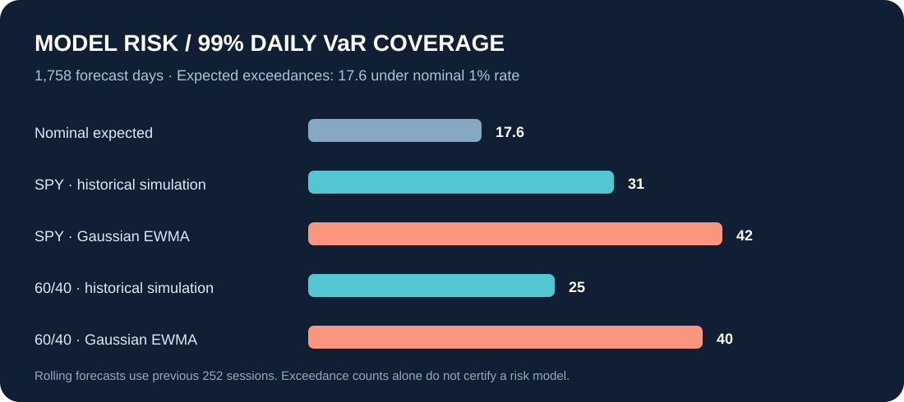

# ATLAS
### Quantitative Trading & Decision Intelligence

**Research the market. Test the strategy. Understand every decision.**

An evolving quantitative trading research platform connecting **portfolio analytics, cost-aware strategy testing, risk validation and evidence-driven trading decisions**.

**ATLAS v1.2 — working research core** · **ATLAS 2.0 — product vision in development**

[**Overview**](#overview) · [**Capabilities**](#capability-status) · [**Research results**](#verified-research-evidence) · [**Getting started**](#getting-started) · [**Roadmap**](#atlas-20-roadmap) · [**Limitations**](#research-integrity--limitations)

> [!IMPORTANT]
> **Current product boundary:** ATLAS is an independent, educational **quantitative-finance research prototype**, not a broker, live trading terminal, market-data vendor, deployed trading desk or proven source of trading alpha. ATLAS 2.0 components described as **planned** below do **not** exist yet. No real-money order execution is enabled.

## Overview

A backtest can appear convincing while hiding costs, regime exposure, timing mistakes or weak risk assumptions. ATLAS approaches trading as a **decision-and-evidence problem**, not merely a search for attractive equity curves.

Today, the repository provides a reproducible Python workflow for:

**Historical ETF prices → data/provenance checks → past-only allocation rules → assumed transaction costs → risk and stress analysis → independent metric reconciliation → research reports.**

**Who it is for:** quantitative finance students, systematic trading researchers, trading-desk candidates and risk analysts who want to examine *why a portfolio or strategy behaves as it does* and *what the evidence cannot establish*.

**Where it is heading:** an integrated workspace for discretionary and quantitative traders, connecting market context, trade plans, execution records, research, paper simulations, risk limits and post-trade analysis—without pretending that simulated alternatives were observed outcomes.

### The intended ATLAS difference

The proposed **Trade Intelligence Engine** will distinguish four kinds of information that are often conflated:

| Category | Meaning |
|---|---|
| **Observed** | What the market or trader actually recorded, with source and timestamp |
| **Planned** | The trader's contemporaneous strategy, order or risk rule |
| **Simulated** | What a *model* suggests might happen under explicit alternative assumptions |
| **Unknown** | What available data cannot reliably reconstruct or establish |

Future features such as **Trade Autopsy**, **Decision Twin**, **Personal Edge Map** and **Strategy Robustness Gate** are intended to connect those four categories in one reviewable workflow. These are **research and product goals**, not implemented capabilities or a demonstrated competitive advantage.

## Capability status

The table below separates the existing codebase from the longer-term product concept.

| Domain | Status | Scope / important boundary |
|---|---|---|
| Historical ETF ingestion and reproducible snapshots | **Implemented; exercised** | Commit-pinned source files, hashes and clearly labeled synthetic datasets; upstream corporate-action adjustments and licensing not independently verified |
| Portfolio rules and research backtesting | **Implemented; exercised** | Equal/fixed weights, inverse volatility, momentum, CVaR and heuristic regime research; **daily, long-only allocation approximations**, not a full order-based execution simulator |
| Return, drawdown, VaR and Expected Shortfall analysis | **Implemented; exercised** | Rolling historical and Gaussian EWMA VaR, coverage checks, stress windows and reports within stated model assumptions |
| Simulated trading-desk RFQ / pre-trade gate | **Prototype** | Illustrative assumptions and simulated limit decisions; **no actual order routing or executable order-book quotes** |
| Machine-learning downside classifier | **Experimental** | Past-only fitting and baseline comparison; **no demonstrated predictive edge or calibrated probability guarantee** |
| Python CLI, Streamlit research dashboard and CI | **Implemented; tested within scope** | Source checkout and research workflow; not yet an authenticated multi-user trading product |
| Market terminal, watchlists, scanners and alerts | **Planned** | No production-ready trading terminal or real-time market feed |
| Trade journal, fill-level portfolio ledger and broker imports | **Planned** | Historical research weights are not a reconciled execution ledger |
| Paper trading, execution replay and market making | **Planned** | No durable paper broker, order lifecycle, depth/queue simulation or live execution |
| Trade Autopsy, Decision Twin and Personal Edge Map | **Planned differentiators** | Need contemporaneous trade evidence, honest counterfactual models and validation |
| AI research assistant and broker integrations | **Future exploration** | No AI trading authorization, broker credentials, live trading or paid infrastructure |

**Development status:** The ATLAS 2.0 [Stage 0 engineering audit](docs/atlas2/STAGE_0_AUDIT.md) is complete **on a separate review branch** ([PR #1](https://github.com/yavuzaksoyy06-create/ATLAS-Cross-Asset-Trading-Risk-Research/pull/1)), with additional regression fixes and **69 locally passing tests** on Python 3.12. That work has **not** been merged into `main` at the time of this README update. Stage 1 product/competitor research has been initiated, but no completed new trading product feature is claimed.

## Verified research evidence

The existing empirical case study uses SPY, QQQ and TLT as *ETF proxies* for equity and duration exposures, not as a comprehensive tradable market universe.

| Research configuration | Documented value |
|---|---|
| Historical window | **2018-01-02 to 2025-12-31** |
| Aligned closes / return sessions | **2,011 / 2,010** |
| Portfolio research rules | **60% SPY / 40% TLT**, equal thirds, 63-session inverse volatility |
| Comparison | Cost-modeled passive SPY |
| Rebalance frequency | Every **21 sessions** |
| One-way turnover cost | **8 bps assumed**, not an observed historical execution |
| Reference audit | **48 metrics reconciled** in a [successful historical GitHub Actions run](https://github.com/yavuzaksoyy06-create/ATLAS-Cross-Asset-Trading-Risk-Research/actions/runs/39064709600) |

### A useful negative result: diversification was not free

**Retrospectively reviewed 2023–2025 segment:**

| Allocation | CAGR | Annualized volatility | Max drawdown |
|---|---:|---:|---:|
| Cost-modeled SPY buy-and-hold | **23.00%** | 15.34% | -18.76% |
| 60% SPY / 40% TLT | 13.33% | **11.40%** | **-12.70%** |
| Equal thirds | 18.18% | 12.98% | -14.54% |
| Inverse volatility (63 sessions) | 16.50% | 12.34% | -13.44% |

These allocation comparisons model costs, but they are **not** independently validated live strategies. The 2023–2025 observations were reviewed prior to publication: **this is not an untouched out-of-sample evaluation**.

### Two market shocks, different hedge behavior

| Ex-post historical stress replay | Cost-modeled SPY | 60/40 portfolio |
|---|---:|---:|
| 2020 COVID/liquidity episode | -33.40% | -15.81% |
| 2022 inflation/duration repricing | -23.83% | -27.13% |

The 60/40 proxy reduced losses in the selected 2020 window but did worse in the selected 2022 window. That is an **ex-post observation**, not evidence of a future regime detector.

### Challenge the risk model

Across **1,758 one-day VaR forecasts**, a nominal 99% model implies about **17.6 expected exceptions**. For SPY, the reproduced count was **31** under historical simulation and **42** under Gaussian EWMA.

These counts raise calibration questions; they do **not** certify bank-regulatory model validity or future tail-risk prediction.

**Go deeper:** [Full empirical findings](research/real_market_2018_2025/EMPIRICAL_FINDINGS.md) · [Methods](docs/RESEARCH_METHODOLOGY.md) · [Model risk register](docs/MODEL_RISK_REGISTER.md).

## Architecture

### Current research pipeline — implemented

~~~mermaid
flowchart LR
    A[Historical or synthetic data] --> B[Provenance and validation]
    B --> C[Past-only allocation research]
    C --> D[Assumed transaction costs]
    D --> E[Return and drawdown]
    D --> F[VaR and stress analysis]
    E --> G[Reference checks and reports]
    F --> G
    G --> H[CLI and Streamlit research UI]
~~~

### ATLAS 2.0 product workflow — planned, not yet implemented

~~~mermaid
flowchart LR
    M[Market context and strategy] --> P[Trade plan and risk budget]
    P --> X[Paper execution and recorded fills]
    X --> J[Trade journal and portfolio ledger]
    J --> I[Trade Intelligence Engine]
    I --> Q[Observed vs planned vs simulated vs unknown]
    Q --> R[Evidence-backed review]
~~~

The longer-term design includes a **Market Workspace**, **Quant Research Lab**, **Risk Command**, **Paper Trading & Replay**, **Trading Journal**, and **Trade Intelligence Engine**. The research core is intended to be reused rather than rewritten merely for a visual redesign.

## ATLAS 2.0 roadmap

Stages are gated by code, test evidence, data rights and explicit review—not by attractive screenshots.

| Stage | Intended milestone | Status |
|---|---|---|
| 0 | Audit, preservation, regression corrections | **Completed on review branch; PR open** |
| 1 | Product research and foundational data/contracts review | **Research underway; no new platform release** |
| 2 | Market workspace: charts, watchlists and source/freshness labels | Planned |
| 3 | Timestamped trade journal and reconciled portfolio ledger | Planned |
| 4 | Strategy development, cost-aware backtesting and execution simulation | Planned |
| 5 | Expanded portfolio risk intelligence and limit governance | Planned |
| 6 | Persistent paper trading and deterministic replay | Planned |
| 7 | Trade Autopsy, feasible counterfactuals and Trade Intelligence | Planned |
| 8 | Microstructure and market-making research | Planned |
| 9 | Optional evidence-grounded AI research assistance | Planned |
| 10 | End-to-end integration, security review, private beta and portfolio release | Planned |

See the [ATLAS 2.0 engineering roadmap](docs/atlas2/MASTER_ROADMAP.md) for technical acceptance criteria. Individual stage priorities may change following documented competitor/user research. **Live broker execution, paid data feeds and public multi-user deployment are not authorized by this roadmap.**

## Getting started

Use a **source checkout** for the current application. **Python 3.11–3.13** is the tested CI range; the package metadata currently declares Python >=3.10, which is broader than the audited CI matrix.

~~~bash
git clone https://github.com/yavuzaksoyy06-create/ATLAS-Cross-Asset-Trading-Risk-Research.git
cd ATLAS-Cross-Asset-Trading-Risk-Research

python -m venv .venv
source .venv/bin/activate

python -m pip install -e '.[all]'
python -m pytest -q
streamlit run app.py
~~~

On **Windows**, replace the activation line with `.venv\Scripts\activate`.

The default Streamlit experience uses a **clearly labeled synthetic engineering demonstration**, not the archived historical research data or a real-time broker account.

### Reproduce the historical ETF study

From a source checkout with network access:

~~~bash
python -m atlas.real_study --output results/real_market --repetitions 500
~~~

This retrieves pinned third-party archived prices and checks source-byte identity and numerical results. It **does not** independently verify the original vendor's adjusted-price methodology or data rights. Raw third-party prices are not bundled or redistributed.

The manually triggered [Pinned historical ETF audit](https://github.com/yavuzaksoyy06-create/ATLAS-Cross-Asset-Trading-Risk-Research/actions/workflows/pinned-market-audit.yml) is also available in GitHub Actions; archived workflow artifacts can expire under GitHub retention rules.

**Known packaging issue:** The Stage 0 audit found that running the historical reference study from an isolated installed **wheel** fails because a required reference JSON resource is missing from that distribution. Use the documented **source checkout** until packaging is corrected; do not describe wheel-based historical reproduction as working.

For offline archival reproduction and input-data rules, see [Reproducibility](docs/REPRODUCIBILITY.md).

## Research integrity & limitations

- **No proof of alpha or trade profitability.** Backtested returns are not executable profits or predictions.
- **Reviewed evaluation window.** The illustrated 2023–2025 segment was already inspected, so retrospective findings cannot be presented as an untouched test.
- **Unverified source adjustments and licensing.** A Git hash confirms file identity, not vendor accuracy, adjustment correctness or legal permission to redistribute.
- **Simplified execution.** Fixed 8-bp trading costs do not capture historical bid/ask spread, market depth, impact, queue, latency, borrowing, financing, taxes or settlement.
- **No execution ledger.** Allocation weights and illustrative RFQ quotes are not broker-recorded fills, inventory accounting or a professional trading terminal.
- **Unproven machine-learning skill.** Existing classification research is experimental; successful code tests do not validate a forecast.
- **Risk estimates are conditional.** VaR breaches, Gaussian assumptions, sampling limitations and selected crisis windows must be interpreted cautiously.
- **No institutional affiliation or approval.** ATLAS is an independent research project, not built for or endorsed by a bank, brokerage or exchange.
- **No live trading.** Paper execution, market making and broker connections shown in the roadmap are future work.

## Documentation

| Resource | Purpose |
|---|---|
| [Empirical findings](research/real_market_2018_2025/EMPIRICAL_FINDINGS.md) | Historical results, interpretation and research caveats |
| [Research methodology](docs/RESEARCH_METHODOLOGY.md) | Assumptions, calculations and statistical definitions |
| [Model risk register](docs/MODEL_RISK_REGISTER.md) | Failure modes, data and modeling gaps |
| [Source reproducibility](docs/REPRODUCIBILITY.md) | Archived data, commands, provenance and replication |
| [Trading desk simulation](docs/TRADING_DESK_WORKFLOW.md) | What the illustrative RFQ/risk gate does—and does not do |
| [Stage 0 audit](docs/atlas2/STAGE_0_AUDIT.md) | Executed test evidence, defects and release limitations on the review branch |
| [ATLAS 2.0 roadmap](docs/atlas2/MASTER_ROADMAP.md) | Proposed staged product architecture and acceptance gates |
| [Technical interview brief](docs/RECRUITER_BRIEF.md) | Concise explanations, defensible results and limitations |
| [Release notes](RELEASE_NOTES.md) | Research-core release history |

---

**Built as an independent quantitative research and engineering portfolio project.**

*Reproducible evidence first. Better trading decisions are a research objective—not a promised outcome.*

