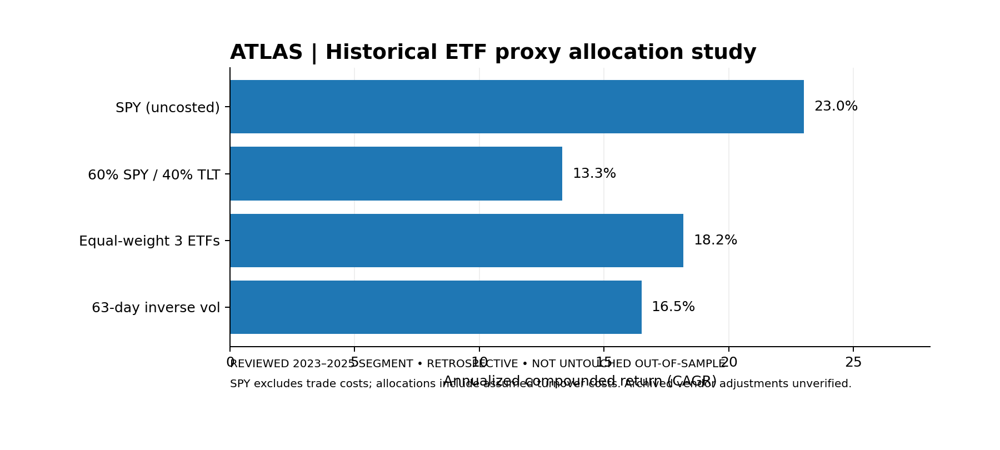
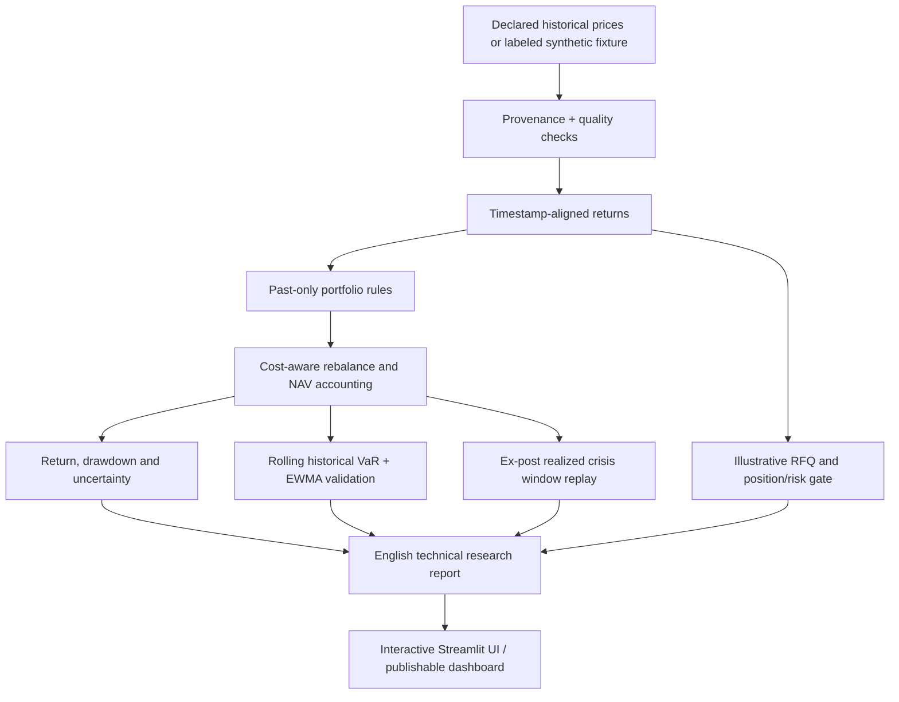

<div align="center">

# ATLAS
### Cross-Asset Trading & Risk Intelligence

**Reproducible portfolio research · Market risk validation · Historical stress testing · Simulated trading-desk decisions**

[](#quality--testing) · [Research memo](research/real_market_2018_2025/HISTORICAL_REFERENCE.md) · [Model risk register](docs/MODEL_RISK_REGISTER.md) · [Reproducibility](docs/REPRODUCIBILITY.md)

</div>

> **Status: v1.2 portfolio research release.** ATLAS is an independent, educational quantitative-finance engineering project. It is **not** affiliated with J.P. Morgan, a brokerage, or a data vendor; it has no live execution, licensed proprietary pricing, or verified trading alpha. The application supports both **synthetic engineering fixtures** and a **pinned historical ETF archive**, always labeled separately.



*2018–2025 archived adjusted-close-claimed ETF analysis; the 2023–2025 comparison period was reviewed retrospectively and is not an untouched independent validation set. The passive SPY series shown is **before trading costs**; the institutional audit adds a costed buy-and-hold benchmark.*

## Executive summary

ATLAS approaches research from the perspective of a portfolio-risk analyst supporting a trading desk. Rather than fit a price predictor and declare a winning strategy, it connects **instrument returns, defensible allocation rules, transaction-cost modeling, historical risk calibration, stress-window analysis and trade risk limits** into a traceable workflow.

The empirical example uses archived **SPY (US equities), QQQ (Nasdaq-100 equities), and TLT (long-duration US Treasury bonds)**: 2,011 aligned daily prices from **2018-01-02 to 2025-12-31**. Corporate-action adjustments, data rights and original vendor quality were **not independently validated**. The source is a [public, commit-pinned third-party archive](https://github.com/revred/TradeSmart.Tracker), not a licensed institutional feed.

**Finding worth discussing in interviews:** Over the retrospectively reviewed 2023–2025 segment, the passive SPY proxy showed higher historical CAGR (23.00% before costs) than the tested 60/40 allocation (13.33% after assumed costs), but also a deeper drawdown (-18.76% vs. -12.70%). Reduced drawdown is not evidence of alpha, and an index benchmark is not a real transaction-cost-matched control without further analysis. The institutional analysis explicitly adds the costed control.

### Architecture



## Research capabilities

| System | What is implemented | Scientific / trading limitation |
|---|---|---|
| Data lineage | Pinned archive commit and per-file Git blob verification; SHA256 local snapshots and source manifests | Hashes verify *bytes*, not provenance truth, corporate actions or redistribution rights |
| Portfolio allocation | Long-only equal weight, inverse volatility, momentum, heuristic regimes, minimum empirical CVaR; fixed 60/40 case study | ETFs are ex-post selected asset-class proxies, not complete historical investable markets |
| Backtesting | Daily close-to-close holdings, capital-aware drift, rebalances and modeled fee/slippage on absolute turnover | Closes are not executable trade quotes; financing, market impact and liquidity are simplified |
| Risk model | 95%/99% historical VaR, expected shortfall, drawdowns, Euler risk attribution, rolling historical simulation vs Gaussian EWMA | Historical estimates do not cap future losses; sparse tail events undermine power |
| Coverage diagnostics | Kupiec exceedance ratio and Christoffersen independence / conditional coverage | Asymptotic p-values with small exception counts may mislead |
| Stress testing | Explicit *hypothetical* one-step shocks **separate from** ex-post historical crisis-window replay | Historical event labels are selected in hindsight |
| Uncertainty | Paired circular moving-block bootstrap of **annualized arithmetic mean daily excess returns** | Exploratory: multiple comparison, non-stationarity, selection bias remain |
| Trading desk scenario | Illustrative quote/spread/impact and funded risk-gated client-inventory change | No order book, desk balance sheet, counterparties or tradable quotes |
| ML appendix | Purged walk-forward event classification with Brier score vs expanding base-rate | Optional experimental benchmark; never advertised as predictive edge |
| Product and quality | Streamlit UI, CLI, unit/integration tests, GitHub Actions, English audit documentation | A unit-test pass is not statistical validation |

## Quick start

Requirements: **Python 3.10 or later**. A terminal is sufficient. Quoted commands below use POSIX shells; on Windows use `.venv\Scripts\activate` rather than `source`.

```bash
python -m venv .venv
source .venv/bin/activate
python -m pip install -e '.[all]'
pytest -q
streamlit run app.py
```

The Streamlit UI defaults to a clearly labeled **synthetic demonstration** so reviewers can run it without network access. Select the **pinned historical** option only when you want the archived real-data example (which needs network access). It also supports CSV upload. Archived vendor daily prices are not bundled.

### Archived historical case study with independent numerical reconciliation

```bash
# Downloads three pinned historical price files and verifies each Git blob SHA1.
# Requires access to raw.githubusercontent.com.
python -m atlas.real_study --output results/real_market --repetitions 500
```

**No network access?** Download the three files from the pinned commit into a local folder named `market_data` (filenames `spy.csv`, `qqq.csv`, `tlt.csv`) and run the exact same validated analysis:

```bash
python -m atlas.real_study --archive-dir market_data --output results/real_market --repetitions 500
```

Local archive mode verifies the **complete raw bytes** against each expected Git blob; it rejects any other files. For a source that is not bit-for-bit identical, use `--input-csv` instead and accept the conspicuous **UNVERIFIED** labeling. No raw provider prices are redistributed in the release.

**Run inside GitHub:** After uploading this code, select **Actions → Pinned historical ETF audit → Run workflow**. That optional workflow downloads the pinned files, checks independent reference results and publishes only aggregate research outputs to an Actions artifact. Until it succeeds, describe the archived study as a *separately calculated reference*, not as an end-to-end Python run performed in this environment.

On success, the output contains:

```text
results/real_market/
├── reference_reconciliation.json          # Independent numerical results check
├── CASE_STUDY.md                          # Earlier (uncosted) reference comparison
├── derived_daily_returns.csv              # Derived net rule returns; kept locally
├── result.json                            # Pinned source manifest and earlier metrics
└── institutional/
    ├── EMPIRICAL_RESEARCH_MEMO.md          # Primary English publication report
    ├── research_dashboard.html            # Interactive risk and return diagnostics
    ├── performance_summary.csv
    ├── historical_stress_windows.csv
    ├── risk_model_diagnostics.csv
    ├── cost_sensitivity.csv
    ├── uncertainty_intervals.csv
    ├── reproduction_manifest.json
    └── OUTPUT_SHA256.json
```

**Offline validation without network (explicitly synthetic):**

```bash
python examples/generate_synthetic_fixture.py
python -m atlas.real_study --input-csv examples/synthetic_3etf.csv \
  --synthetic-fixture --repetitions 100 --output results/synthetic_institutional
```

This is for software acceptance testing only, NOT actual trading performance.

**Offline rerun on your own adjusted-price panel:**

```bash
python -m atlas.real_study --input-csv path/to/prices.csv --output results/local-audit
```

The CSV must have columns `Date,SPY,QQQ,TLT`, sorted ascending, with strictly positive prices. Input CSVs are explicitly labeled **UNVERIFIED**, unless `--synthetic-fixture` is supplied, in which case results are **SYNTHETIC**. Historical reference reconciliation runs only after the pinned downloader verifies the Git blobs and full date panel. Unlike the pinned archive route, a supplied CSV is **not vendor-verified**. Do not describe synthetic, unadjusted or user-generated CSV as verified historical prices.

### General market research demonstration

```bash
# Deterministic synthetic fixture, clearly labeled; NOT empirical evidence.
atlas --source synthetic --strategy regime --output results/synthetic-demo \
  --freeze-data --evaluate --bootstrap-reps 500 --trade-demo

# With appropriate data rights and verified adjusted prices:
atlas --source csv --csv /path/to/adjusted_close.csv --strategy cvar \
  --freeze-data --evaluate --test-start 2024-01-02 \
  --output results/research-cvar
```

> The general 10-asset `atlas` workflow needs compatible instruments for its regime/cash routing. The pinned three-ETF empirical study has **its own explicitly defined** allocations: run `python -m atlas.real_study` for the apples-to-apples comparison. Strategy selection and cash proxies must not be silently treated as equivalent.

## Historical evidence at a glance

| Rule | 2023–2025 CAGR | Volatility (annual) | Max drawdown |
|---|---:|---:|---:|
| SPY passive, **without trade costs** | 23.00% | 15.34% | -18.76% |
| 60% SPY / 40% TLT, modeled costs | 13.33% | 11.40% | -12.70% |
| One-third each SPY / QQQ / TLT, modeled costs | 18.18% | 12.98% | -14.54% |
| 63-session inverse-volatility, modeled costs | 16.50% | 12.34% | -13.44% |

*Archived price study calculated from historical third-party GitHub files using a separately implemented reference evaluator. The local Python historical-data downloader cannot be executed in the present offline build environment. Exact independently observed reference metrics live in [`HISTORICAL_REFERENCE.md`](research/real_market_2018_2025/HISTORICAL_REFERENCE.md); the institutional audit computes new, cost-aligned and statistically qualified comparisons when rerun with downloadable prices.*

## Quality & testing

- Tests enforce provenance labeling and numerical reference metadata, as well as past-only history access; changing a later date must not rewrite an earlier decision.
- Unit tests check synthetic price validation, costs, reproducible data freezing, no file-tampering, bootstrap determinism, portfolio funding, risk-limit failures, coverage calculations and the full report generation path.
- `.github/workflows/tests.yml` runs the tests for pull requests and pushes.
- The research suite **does not** claim the data vendor, live download route, statistical performance or economic deployability were certified in CI.

More detail: [Reproduction protocol](docs/REPRODUCIBILITY.md), [Research methodology](docs/RESEARCH_METHODOLOGY.md), [Model risk register](docs/MODEL_RISK_REGISTER.md) and [Trading-desk workflow](docs/TRADING_DESK_WORKFLOW.md).

## Research integrity, explicitly

1. **Not untouched out-of-sample:** 2023–2025 was examined before publication. Its reported relative performance is *retrospective*, regardless of deterministic code.
2. **Not an alpha claim:** a reduction in drawdown may trade away upside; economic performance depends on cash yield, costs, implementation and market regime.
3. **Unverified adjustment:** the archived README claims dividend-and-split-adjusted prices, but provider reconciliation has not been performed.
4. **No redistribution of source OHLCV:** third-party raw prices are downloaded at the user's initiative; check vendor terms before use.
5. **No trading execution:** simulated spreads, liquidity participation, close fills, quote-to-trade examples and financing are educational simplifications.
6. **No bank relationship:** the name, workflows and diagrams refer to generic market risk / trading-desk work, not any bank's proprietary system.

## Roadmap

- Validate total-return adjustments against a properly licensed independent provider; establish a truly untouched future test window.
- Add timestamped quote/volume data with explicit liquidity/risk budget constraints, cash-yield and financing curves.
- Add risk-model exception clustering diagnostics at multiple tail levels, with small-sample uncertainty and autocorrelation tests.
- Expand macro models with point-in-time release vintages rather than revised current macro series.
- Record paper-trading decisions with signed side, hedge inventory, turnover and risk approvals, separate from real trading.

## Attribution and use

All ATLAS source code is original independent research code. The third-party price archive is referenced only by URL and hashes; original source files are not copied into the repository. Research education only, not investment advice.

## Release notes and sample

[Release notes](RELEASE_NOTES.md) · [Offline reproducibility example](examples/README.md). The present build environment cannot reach the source host. Use the GitHub Actions pinned-data audit or run the verified archive on an internet-enabled computer. Do not assert empirical enhanced risk results until that run succeeds.
