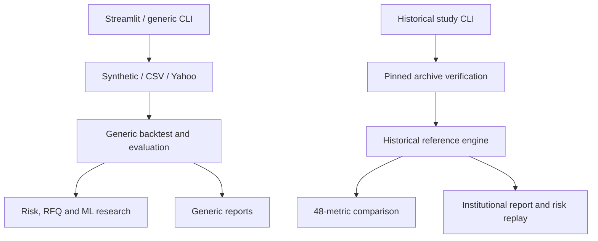

# ATLAS 2.0 — Existing capabilities

Audit baseline: `33da05d887a6af9304013437bdbe42e20d184aa8`. Stage 0 inspection covers all 59 tracked files, 21 Python package modules, the Streamlit entry point, seven original test files, both workflows, documentation and archived research outputs. The added regressions and UI tests are listed separately below. No repository or ancestor `AGENTS.md` was found.

Status meanings: **verified working** means executed successfully within the stated scope; **implemented but unverified** means code exists without sufficient execution evidence; **partially implemented** includes working prototypes with essential gaps or a demonstrated broken route; **absent** means no implementation was found. A software pass does not validate an economic model.

## Feature inventory

| Capability and location | Status | Verification / run command | Data and limits |
|---|---|---|---|
| Synthetic correlated price generator — `data.py` | Verified working | `python examples/generate_synthetic_fixture.py`; unit tests; full synthetic CLI | Seeded SYNTHETIC series; ETF symbols are interface labels. Not historical data. |
| Wide CSV validation and loading — `data.py` | Verified working | Synthetic CSV end-to-end study; invalid-input regressions | Positive finite levels, unique sorted dates/assets; no official exchange calendar or corporate-action reconciliation. |
| Pinned historical HTTPS ingestion — `real_study.py` | Verified working | `python -m atlas.real_study --output results/real_market --repetitions 500` | REAL archived third-party claims: SPY/QQQ/TLT, 2,011 aligned closes, 2018-01-02–2025-12-31. Git blobs verified; vendor adjustments and rights not independently certified. |
| Offline pinned archive directory — `real_study.py` | Implemented but unverified for a valid full local archive | Missing-file/tamper/unknown-symbol tests passed; `--archive-dir market_data` documented | Complete valid local three-file reproduction was not separately run. Network route was run. No raw archive is bundled. |
| Yahoo adapter — `data.py` | Verified working for a small fetch | `yahoo-smoke` evidence: SPY/QQQ, 2025-01-02 to exclusive 2025-01-16 | Returned 9 aligned rows. Availability, adjustments, rate limits and licensing are not guaranteed; adapter silently drops incomplete common dates. |
| Snapshot SHA256 and metadata — `provenance.py` | Verified working | Roundtrip/tamper tests; `atlas --source synthetic --freeze-data ...` | Hash proves bytes unchanged, not authentic pricing or legal permission; snapshot contains raw supplied prices and must remain private unless rights allow distribution. |
| Source labels — `research_labels.py` | Partially implemented | Synthetic exports and pinned CLI verified | Arbitrary Python callers can construct provenance dictionaries. Labels are not an authentication boundary; generic CLI CSVs do not all carry row-level source labels. |
| Generic daily portfolio simulator — `backtest.py` | Verified working within approximation | Five strategies, future mutation, cost, weight and invalid-input tests | Long-only capital fractions, drift, multiplicative costs. Warm-up invests in BIL or **first asset**, not necessarily cash. No shares/cash ledger, execution timestamp or corporate-action ledger. |
| Historical reference simulator — `real_study.py` | Verified working | Full before/after historical runs, 48-metric reconciliation | Three fixed rules; subtractive cost approximation. Intentionally preserved separately from generic simulator; not a broker accounting system. |
| Portfolio accounting / settlement | Partially implemented | Synthetic weight drift and funding checks | No cash/shares/fills/lots/FX/settlement/financing/tax ledger; last returned weights are pre-return exposures, not end-session marked holdings. |
| Equal, inverse volatility, momentum, heuristic regime — `strategies.py` | Verified working on supported synthetic universe | Original parameterized tests; synthetic five-rule evaluation | Regime requires specific symbols. Missing BIL or defensive symbols can change semantics or cause errors. No demonstrated alpha. |
| CVaR allocation — `optimization.py` | Verified working for tested constraints | SciPy HiGHS solve; sum/long-only/position-cap tests; CLI comparison | Dense historical scenario LP, assumed expected-return constraint. No independent optimality certificate tests, broad infeasibility tests or large-universe benchmarks. Warm-up fallback does not enforce an explicit return target. |
| Performance / historical VaR and ES — `risk.py` | Verified working within declared definitions | Initial-loss regression, tail and finite-result tests | Generic drawdown corrected to include initial capital. VaR/ES quantile conventions differ from archived reference summaries. Risk-free rate is zero by assumption. |
| Rolling historical/Gaussian EWMA VaR — `institutional_risk.py` | Verified working | Past-only mutation tests; full historical forecast replay | 252-session window; 1,758 forecasts. Gaussian, zero-mean, daily-close model; not intraday or regulatory validation. |
| Kupiec / Christoffersen diagnostics | Verified working for tested cases | Binary input checks, transition counts and historical replay | Asymptotic rare-event tests; no exact finite-sample or Monte Carlo calibration suite. All-zero/all-one and degenerate-transition interpretation needs stronger tests. |
| Euler risk contributions / hypothetical shocks — `risk.py` | Verified working on supported assets | Contribution sum and shock tests; dashboard and CLI | ASSUMED shock matrix for ten symbols; unknown held symbols error. No factor, Greeks, DV01, liquidity or credit risk platform. |
| Named historical stress windows — `historical_events.py` | Verified working | Unit replay and actual pinned historical study | Ex-post window selection; can return partial windows. User CSV calendar overlap alone never authenticates a historical event. |
| Fixed split evaluation / block bootstrap — `evaluation.py` | Verified working on tested fixtures | Split/mutation/seed/cost tests; five-rule CLI evaluation | Reviewed history is not untouched. Generic comparator is uncosted; paired circular blocks estimate arithmetic mean differences, not CAGR intervals. Multiple testing uncorrected. |
| Reference reconciliation — `reference_validation.py` | Verified working | 48 metrics on full historical runs; NaN tolerance regression | 0.05 percentage-point tolerance; agreement to earlier evaluator is not independent vendor validation. |
| Empirical reporting — `institutional_report.py` | Verified working from source checkout | Historical and synthetic memo/CSV/HTML generation; repeated-publication checksum test | Reused output directories may retain unrelated old files; hashes are not signatures. Preserve dataset labels and use new run directories. |
| Generic reporting / CLI — `report.py`, `cli.py`, `__main__.py` | Verified working for exercised synthetic path | `python -m atlas --source synthetic --freeze-data --evaluate --bootstrap-reps 100 --trade-demo --run-ml --output results/stage0_desk` | Full CLI smoke passed; direct pytest coverage of CLI/report is zero. Failure branches and unsupported CSV assets are not comprehensively tested. |
| Simulated RFQ / pre-trade gate — `rfq.py`, `desk.py` | Verified working as an illustrative gate | Funded/unfunded, pass/reject, finite quote and missing-return regressions; memo export | Invented ADV/spread/impact and limits. BIL funding proxy, no orders, fees debited to cash, inventory market maker or approval authority. |
| Walk-forward downside classifier — `ml.py` | Verified working as experimental research | Synthetic CLI and feature/probability future-mutation tests | Train-only scaler/logistic regression; labels mature before fit. Predicts terminal 5-session return, **not intra-horizon drawdown**. Uncalibrated probabilities, overlapping labels, no untouched historical validation. |
| Streamlit research UI — `app.py` | Partially implemented | AppTest: synthetic screen, real risk button calculation, CSV empty state | Server-side interaction checks passed. No browser visual/accessibility/concurrency tests; no upload stress tests. Pinned source lacks BIL, so RFQ is unavailable by design. Dynamic historical UI uses generic engine, not identical archived methodology. |
| Editable install / source checkout | Verified working | Fresh venv + `pip install -e '.[all]'`; `pip check`; compilation | Tested locally on CPython 3.12.14. Dependencies have minimums but no reproducible hash lock. |
| Wheel distribution | Partially implemented — broken historical route | Wheel build/install passed; installed-wheel historical command failed | `REFERENCE_RESULTS.json` is not bundled; repository-relative lookup fails. Wheel also omits root UI and documentation. Use source checkout until packaging contract is fixed. |
| CI | Verified working at original baseline; Stage 0 results reported in audit/PR | Observed GitHub baseline matrix 3.11/3.12/3.13 and prior manual historical run | Added dashboard job, read-only token permissions and timeouts. Actions use mutable version tags; no lint/type/dependency vulnerability gates yet. |
| Typing, structured logging, deployment security | Partially implemented | Static inspection | Type hints/dataclasses exist; generic dict schemas and print-based output remain. No authentication, authorization, rate limiting, service API or deployment hardening. |
| Market terminal, OHLC charting, watchlists, scanners | Absent | No implementation found | Research NAV charts are not a market charting terminal. |
| Trade journal, persistent ledger, paper trading | Absent | No implementation found | RFQ demonstration does not create paper-account executions. |
| Realistic execution simulator / market making research | Absent | No implementation found | No spread/depth/queue/partial-fill/latency model or order lifecycle. |
| Trade Intelligence Engine / counterfactual trade analysis | Absent | No implementation found | Requires timestamped decision evidence and feasible alternative-path simulator. |
| AI-assisted analysis / grounded explanations | Absent | No implementation found | No LLM API, local model, retrieval or evidence-verification implementation. |
| Live brokerage, exchange execution, production users | Absent and outside authorization | No implementation found | No live financial trading may be enabled without separate explicit authorization. |

## Existing architecture and duplication

Preserve both engines until explicit parity contracts are agreed. Generic net return is `(1-cost)*(1+gross)-1`; historical reference net return is `gross-cost`. They also differ in warm-up, inverse-volatility floor and benchmark treatment. Their results must not share an unlabeled strategy identity. `performance_stats` and `strategy_summary`, two coverage paths, overlapping validators, and `research_qa.cost_sensitivity` versus the report's own sweep are further duplication. Stage 0 does not consolidate them.

No database, API service, migrations, background job queue, Docker setup or durable user domain exists. The current architecture is a local Python research package with file outputs and an optional synchronous Streamlit frontend.
